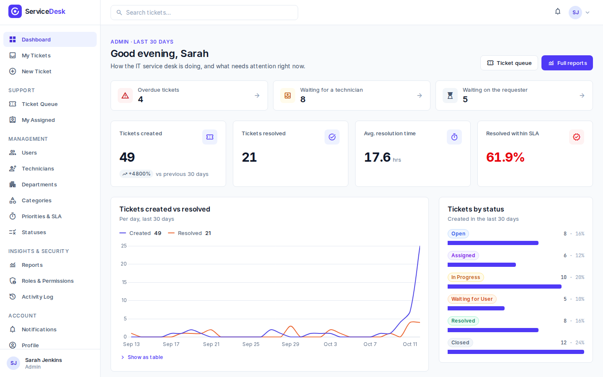
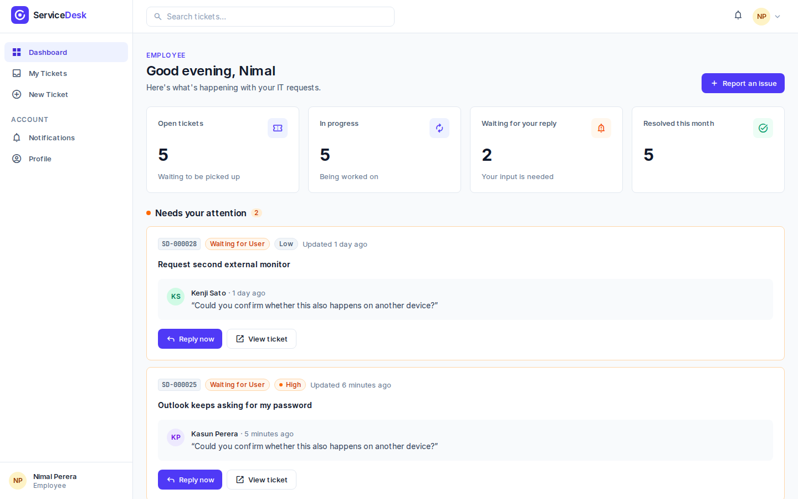
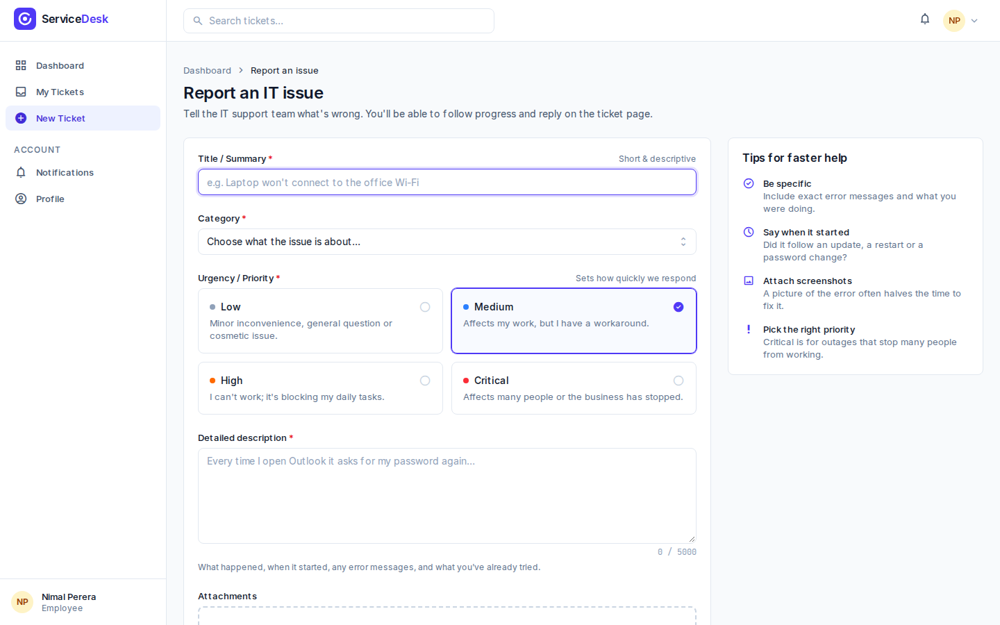
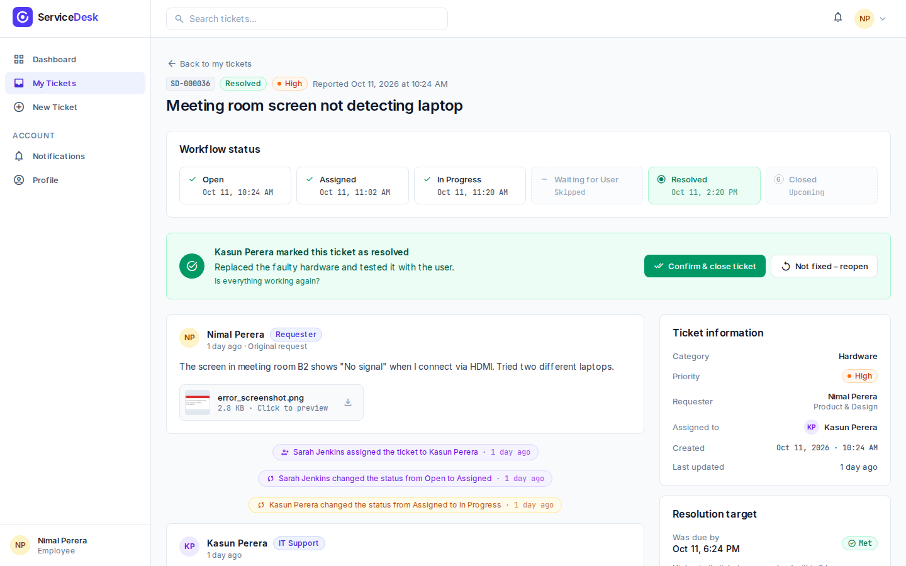
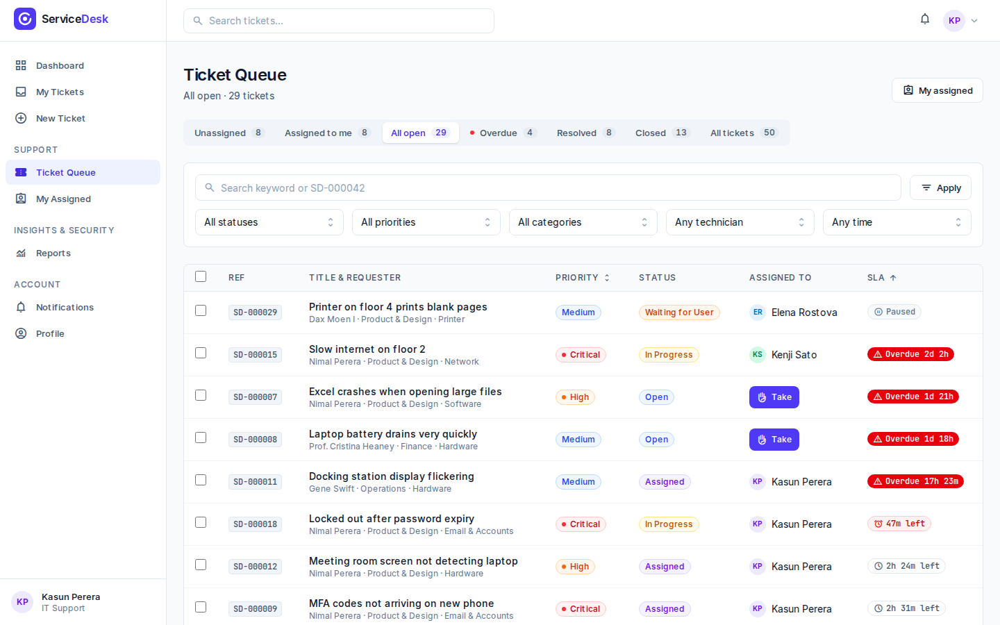
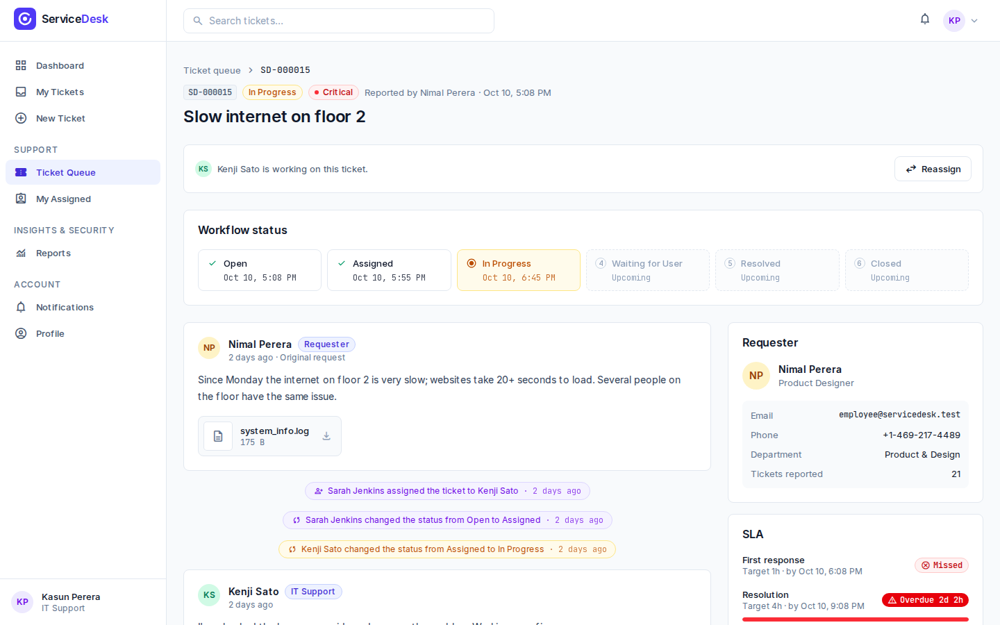
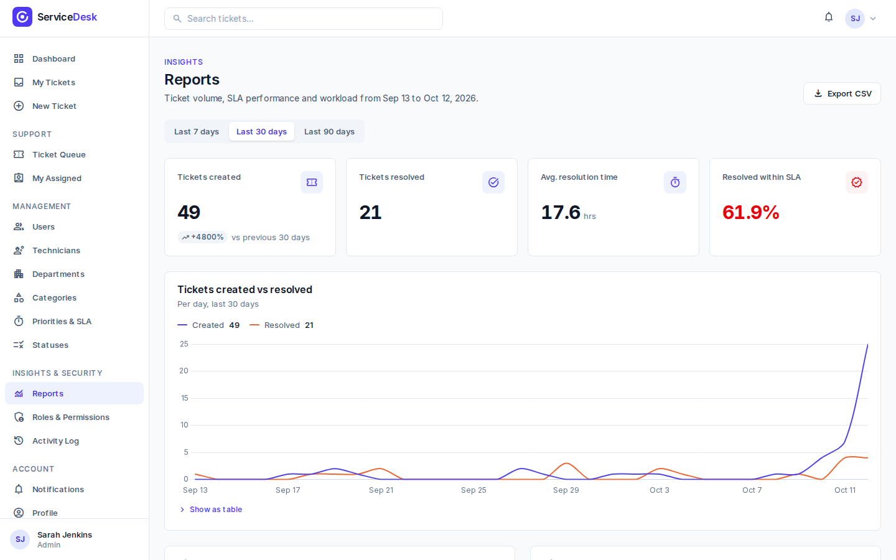
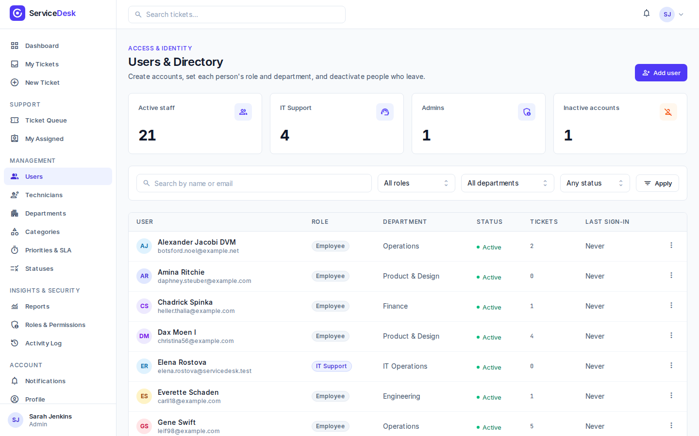
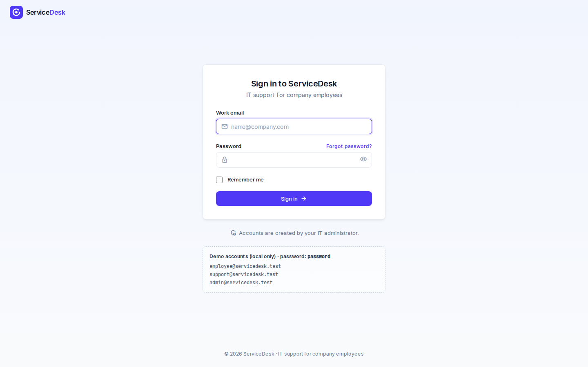
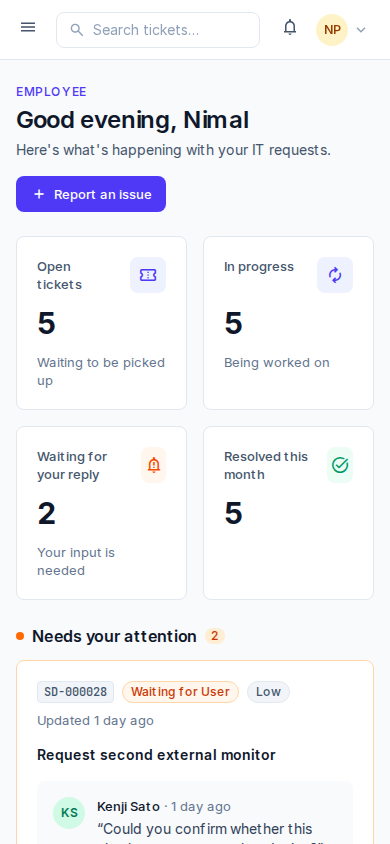

# ServiceDesk – IT Support Ticketing System

[](https://github.com/07rashmika/service_desk/actions/workflows/ci.yml)

ServiceDesk is a web app where employees report IT problems and IT support technicians track them until they're fixed. Every ticket follows one workflow, has a deadline (SLA) based on its priority, and keeps a full history of who did what.



## Features

**Employees**
- Report an issue with a category, priority and attachments (images, PDFs, text files)
- Follow each ticket on a progress tracker, reply to the technician, and confirm or reopen a fix
- Live notifications in the app, plus emails they can switch off by type

**IT Support technicians**
- A ticket queue with tabs (Unassigned, Assigned to me, Overdue…), search, filters, sorting and bulk actions
- Take or assign tickets, ask the requester for information, add internal notes, and resolve with a solution
- SLA timers that count down live and warn before a deadline is missed

**Admins**
- Dashboard and reports: volume over time, SLA compliance, results by category, department and technician, and CSV export
- Manage users, departments, categories, priorities with their SLA hours, status colours, and role permissions
- An activity log of every important change

**Under the hood**
- Workflow: **Open → Assigned → In Progress → Waiting for User → Resolved → Closed**, with only the allowed transitions
- The SLA clock pauses while waiting for the requester; resolved tickets close automatically after 3 days
- A REST API (`/api/v1`) with token sign-in, for mobile apps or integrations
- Real-time updates over WebSockets (Laravel Reverb)

## Screenshots

| Employee dashboard | Report an issue |
| --- | --- |
|  |  |
| **Ticket waiting for confirmation** | **Ticket queue** |
|  |  |
| **Working on a ticket** | **Reports** |
|  |  |
| **Users & roles** | **Sign in** |
|  |  |

Every page also works on phones:



## Tech stack

| Area | Tools |
| --- | --- |
| Backend | PHP 8.5, Laravel 13, MySQL 8 |
| Frontend | Blade components, Tailwind CSS 4, Alpine.js, Chart.js |
| Sign-in & permissions | Laravel Fortify, Laravel Sanctum (API tokens), Spatie Laravel Permission |
| Real time | Laravel Reverb, Laravel Echo |
| Quality | PHPUnit, Laravel Pint, Larastan, GitHub Actions |

## Getting started

### What you need

- PHP 8.5 with the `pdo_mysql`, `mbstring`, `gd` and `intl` extensions
- Composer 2
- Node.js 22 (or 20.19+) and npm
- MySQL 8

### 1. Get the code and install packages

```bash
git clone https://github.com/07rashmika/service_desk.git
cd service_desk
composer install
npm install
```

### 2. Create the environment file

```bash
cp .env.example .env
php artisan key:generate
```

Open `.env` and set your database details:

```env
DB_CONNECTION=mysql
DB_HOST=127.0.0.1
DB_PORT=3306
DB_DATABASE=servicedesk
DB_USERNAME=your_mysql_user
DB_PASSWORD=your_mysql_password
```

Then give Reverb (the real-time server) its own ID, key and secret. Any random values work locally:

```env
REVERB_APP_ID=servicedesk
REVERB_APP_KEY=any-random-string
REVERB_APP_SECRET=another-random-string
```

### 3. Create the database and the demo data

Create an empty database called `servicedesk` in MySQL, then run:

```bash
php artisan migrate --seed
```

This adds the departments, categories, priorities, statuses and roles, and, outside production, demo users with about 50 realistic tickets.

### 4. Run it

```bash
composer run dev
```

This one command starts everything: the web server, the Vite asset server, the queue worker (for emails and notifications), the Reverb WebSocket server, the scheduler (SLA alerts and auto-close) and a log viewer.

Open **http://localhost:8000** and sign in.

### Demo accounts

All demo accounts use the password `password`.

| Role | Email | Can |
| --- | --- | --- |
| Admin | `admin@servicedesk.test` | Everything, including users, settings, reports and the activity log |
| IT Support | `support@servicedesk.test` | Work on the ticket queue |
| Employee | `employee@servicedesk.test` | Report and follow their own tickets |

Emails (password resets, notifications) aren't really sent locally. They're written to `storage/logs/laravel.log`.

## Running the checks

```bash
php artisan test                                       # all tests
vendor/bin/pint --test                                 # code style
vendor/bin/phpstan analyse --memory-limit=1G           # static analysis
```

GitHub Actions runs all three, plus a package security audit, on every push and pull request to `main` and `developing`.

## REST API

The API lives under `/api/v1`. Get a token with your email and password, then send it as a bearer token:

```bash
curl -X POST http://localhost:8000/api/v1/auth/token \
  -H "Accept: application/json" \
  -d "email=employee@servicedesk.test" -d "password=password" -d "device_name=my-laptop"

curl http://localhost:8000/api/v1/tickets \
  -H "Accept: application/json" \
  -H "Authorization: Bearer <token>"
```

Tokens last 30 days. A ready-made Postman collection with every request is in [`docs/postman`](docs/postman). Import both files and pick the **ServiceDesk Local** environment.

## Security

- Every page and API route requires sign-in, and the right role or permission. A test walks through all routes to make sure of this.
- Passwords need at least 8 characters. In production, passwords found in known data breaches are rejected.
- Sign-in, API tokens, new tickets, replies and invite emails are rate limited.
- Attachments are stored privately and are only served to people allowed to see the ticket.
- Every response carries security headers (no framing, no MIME sniffing, a strict referrer policy, and HSTS over HTTPS).

For production, set `APP_ENV=production`, `APP_DEBUG=false`, `SESSION_SECURE_COOKIE=true`, and use HTTPS.

## Project structure

| Folder | What's inside |
| --- | --- |
| `app/Actions` | One class per business action (create ticket, take, assign, resolve…). Status changes only happen in `TransitionTicket`. |
| `app/Enums` | The workflow states, roles and permissions |
| `app/Http/Controllers` | Web controllers, plus `Api/V1` for the REST API |
| `app/Policies` | Who may view, take, assign or close each ticket |
| `app/Reports` | The numbers behind the dashboard and reports |
| `resources/views/components` | Reusable Blade UI components (buttons, badges, tables, modals, SLA timer…) |
| `tests/Feature` | Feature tests, grouped by area |
